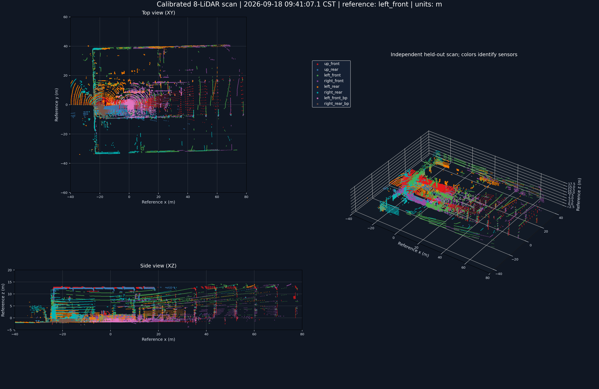
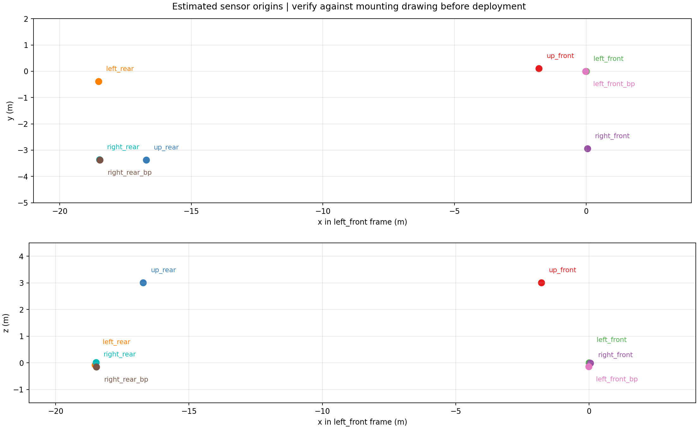
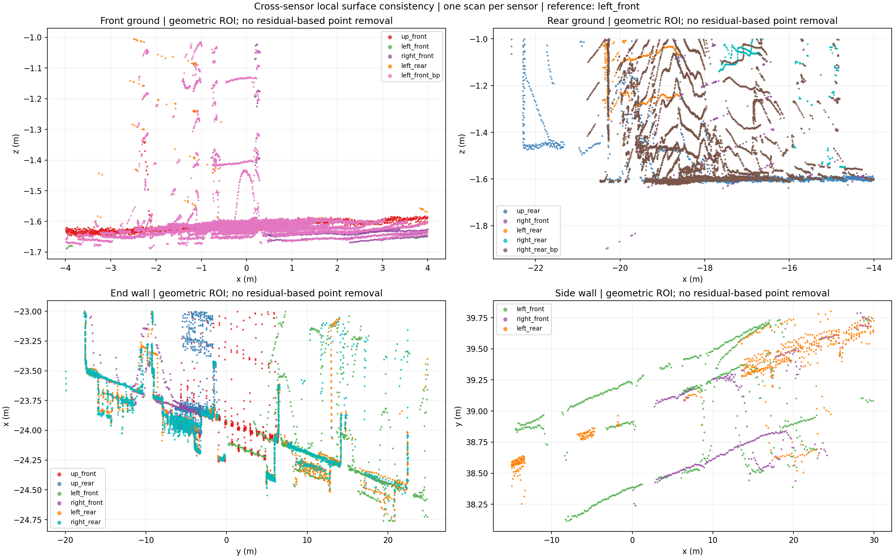

# ZPMC Multi-LiDAR Calibration Skill

面向 AGV 等多激光雷达系统的静态外参标定 skill：**先检查数据，再配准、独立验证和可视化，最后按需生成车体坐标系与 ROS 2 TF。**

不以“图片看起来重合”代替验证，不把表面残差当作外参绝对精度。适用于有重叠结构的多路静态点云，包括低共视、侧装/倒装以及部分损坏数据的有界处理。

## 可视化示例

下面三张图来自已有历史运行，经项目所有者要求作为文档示例收录。它们使用图中标明的 **`left_front` 雷达参考系**，不是当前新定义的 `base_link`，也不是最新数据包的结果。图中的日期、场景和安装布局只描述该次示例，不是软件默认参数或精度承诺。

### 八雷达单帧点云拼接

每路各一帧，按雷达着色，展示俯视、侧视与三维点云；不是训练多帧累计图。



### 安装位置与高度关系

用于核对雷达位置、基线及安装高差。此历史图只展示传感器原点；新流程可生成各路自身 XYZ 轴和明显 `base_link` 的离线交互网页。



### 局部地面与墙面检查

展示几何 ROI 中的实际点云，不按最终残差删点美化。保留可见错层和离散回波，便于发现问题，而不是宣称全部点达到同一精度。



仓库只包含这三张静态示例图、可复用说明/代码及明确标记的合成输入；不附带原始 bag、原始点云、真实外参、项目日志或可下载真实点云的 HTML。

## 功能与边界

| 环节 | 能力 |
|---|---|
| 数据检查 | 指导实际读取/解码、schema、时间戳、静态性和损坏范围检查；不是只相信 metadata |
| 配准 | 可信初值基础上的多雷达联合点到面精配准、稳健权重、几何可观测性检查 |
| 验证 | 预先拆分 train/validation/test、统一口径比较、初值/体素敏感性与分帧复算 |
| 车体坐标系 | 显式选择四路主雷达定义 X前/Y左/Z上；保留对角中心对称与左右镜像不等价的安装规则 |
| 轴向切换 | X右/Y前/Z上 → X前/Y左/Z上，保留原点与物理 Z 轴，不只修改欧拉角 |
| 3D 布局 | 每路本地 XYZ 轴、醒目的 base_link、等比例显示、离线 HTML |
| TF 导出 | JSON/YAML → ROS 2 静态 TF launch XML；只生成文件，不启动节点 |

这是 **agent 工作流 + 可调用工具**，不是无需初值的一键标定器。ROS bag 解码、全局初始化、点云拼接可视化/报告由 agent 按 skill 指导组织，仓库未打包专用 bag 解码器或全自动部署系统。`sensor_layout.py` 只绘制坐标轴布局，不绘制点云。

标定支持合理的任意雷达路数；当前 `define_base_link.py` 的中心估计模式专门实现“恰好四路主雷达”的规则，其他雷达只随之换基。不同车体定义应先确认后适配，而不是强行套用。

## 目录

```text
skills/multi-lidar-calibration/
  SKILL.md
  agents/openai.yaml
  requirements.txt
  requirements-registration.txt
  references/
  scripts/
    registration.py
    define_base_link.py
    sensor_layout.py
    export_tf_launch.py
examples/
  synthetic_extrinsics.json
  vehicle_layout.json
docs/images/
```

## 安装 skill

克隆本仓库后，将 `skills/multi-lidar-calibration/` 整个目录放到目标工程的 `.agents/skills/` 下；若已有同名 skill，先比较内容，不直接覆盖。该仓库式发现位置见 [OpenAI 官方 skills 文档](https://learn.chatgpt.com/docs/build-skills#where-codex-loads-local-skills)。

也可让 Codex 的 `$skill-installer` 从此 GitHub 仓库安装，指定子目录 `skills/multi-lidar-calibration`。本仓库提供独立 skill，未注册插件市场或自动更改用户环境。

示例请求：

```text
使用 $multi-lidar-calibration 检查这个静态多雷达 bag。
先确认数据完整性和安装方向，再估计外参并使用独立帧验证。
每次运行放到独立结果目录，不覆盖原始数据和上次结果。
```

```text
使用 $multi-lidar-calibration，将已有外参按确认的四路主雷达布局
定义为 X前、Y左、Z上的 base_link，生成离线 3D 坐标轴网页和 TF XML。
其他雷达不参与车体定义，但仍须一起换基；不要重新标定或启动 TF。
```

## Python 环境

Python 3.10+。优先使用已有环境；新环境只在允许写入的目录创建，不升级系统 ROS 或全局包。

```bash
python3 -m venv .venv
source .venv/bin/activate
mkdir -p .runtime/tmp .runtime/cache/pip
export TMPDIR="$PWD/.runtime/tmp"
export XDG_CACHE_HOME="$PWD/.runtime/cache"
export PIP_CACHE_DIR="$PWD/.runtime/cache/pip"
python -m pip install -r requirements.txt
```

上面足够运行车体换基、3D 布局和 TF 导出。配准脚本额外需要 Open3D：

```bash
python -m pip install -r requirements-registration.txt
```

兼容的 CPU 版 Open3D 也可提供 `open3d` 导入；不要在同一环境同时安装两种发行包。当前验证环境为 Python 3.10、NumPy 1.26.4、SciPy 1.15.3、Plotly 7.1.0、Open3D CPU 0.19.0、PyYAML 6.0.3；版本范围并不代表已测试所有平台和组合。脚本不会自行联网安装依赖。

## 无真实数据的快速演示

`examples/synthetic_extrinsics.json` 是手工构造的八雷达几何，**不是实际标定，不可用于机器人部署**。布局 JSON 显式列出参与定义的四路、对角配对和原参考系中的上方向；实际使用时必须改成用户确认的 ID/方向。

```bash
SKILL_DIR=skills/multi-lidar-calibration
mkdir -p work

python "$SKILL_DIR/scripts/define_base_link.py" \
  --extrinsics examples/synthetic_extrinsics.json \
  --layout examples/vehicle_layout.json \
  --output work/extrinsics_base_link.json

python "$SKILL_DIR/scripts/sensor_layout.py" \
  work/extrinsics_base_link.json --output work/sensor_layout.html

python "$SKILL_DIR/scripts/export_tf_launch.py" \
  --extrinsics work/extrinsics_base_link.json \
  --output work/multi_lidar_tf.launch.xml
```

浏览器离线打开 `work/sensor_layout.html` 即可旋转、缩放、选择雷达。默认不覆盖已有文件；确认更新时才加 `--overwrite`，任何模式都不能覆盖输入。

合成示例包含恰好 90° 的侧装姿态，RPY 转换可能提示万向节锁；此时欧拉角表示不唯一，不影响旋转矩阵和四元数，应以后二者为准。

`registration.py refine/evaluate` 的 NPY/NPZ、数据集拆分和初值契约见 [配准脚本说明](skills/multi-lidar-calibration/references/script-interface.md)。配准输出的 `poses` 不是直接给 TF 导出器的完整外参；需明确真实 frame_id、参考系和米制，再转换为 [外参 JSON/YAML 契约](skills/multi-lidar-calibration/references/tf-launch.md)。

## 使用时必须保留的限制

- 同场景重复性、数值收敛、表面残差和测量真值精度是不同概念。
- 小残差不能消除低共视或弱方向；不同初值/体素出现相近残差的不同解，应保留候选和警告，不强行给出唯一外参。
- `converged=false` 不能改写成成功；固定参数后才评估测试集。
- 四路布局中心是用户定义的近似，不是 CAD/测量真值；不强制左右镜像、不抹平高差、不旋转单个雷达来“修正”安装。
- TF、JSON 与网页同源一致只能证明换基/导出正确，不能替代工程验收。部署需另行授权，不能与已有同 child 的发布器重复发布。

详见 [可靠性边界](skills/multi-lidar-calibration/references/reliability.md) 和 [base_link 定义](skills/multi-lidar-calibration/references/base-link.md)。
